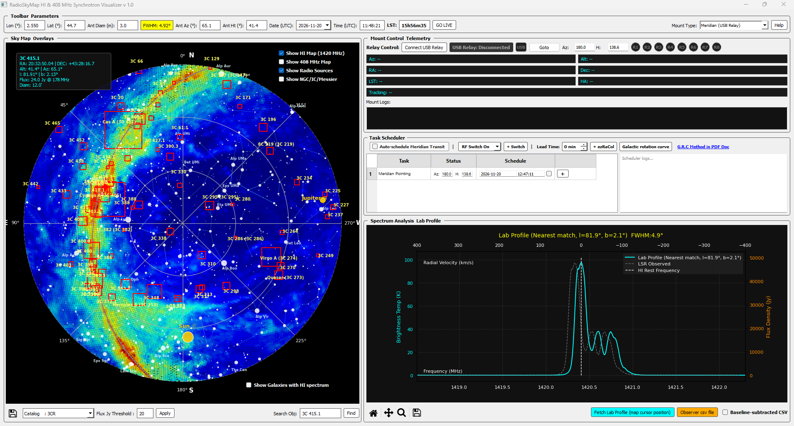
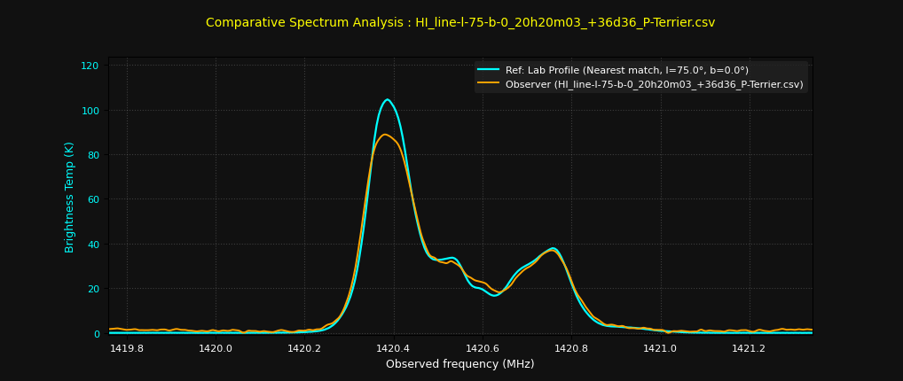

# RadioSkyMap v 1.0  
HI & 408 MHz Synchrotron Visualizer desktop software for Windows 10-11 and Linux ubuntu 26.04

**RadioSkyMap on Cas A with Lab Survey curve for 30m Radio Telescope, mount moved with ASCOM-Hub interface** 

## Releases:
## Windows 7-10-11
To download [RadioSkyMap\_Setup\_v1.0.zip - 2026-11-26](https://www.rmob.org/file/RadioSkyMap_Setup_v1.0.zip)

To install unzip and run setup

## Linux Ubuntu & derivatives (Not available now please wait)

------------------------------------------------------------

user guide inclued in the software (click on "?" in top bar)

## 1. Overview

**RadioSkyMap** is an desktop application designed for radio astronomy enthusiasts and amateur astronomers. It provides a **real-time sky map **with (azimuth/elevation) overlaid with **Neutral Hydrogen (HI) emission data (Leiden/Argentine/Bonn (LAB) survey), 408 MHz synchrotron continuum maps (haslam Remazeilles 2014)**, and major celestial radio source catalogs (such as **3CR,Third Cambridge Catalogue of Radio Sources (3C Revised), Parkes PKSCAT90 - The Southern RadioSource Database**, **GLEAM 4-Jy (G4Jy) catalog**, **Messier, NGC,IC catalog** ).  Alongside spectral profile data acquisition from the **Leiden/Argentine/Bonn (LAB) survey**  off line local databases , and **55 HI Galaxy spectra from professional observatory**. It also integrates seamlessly with **ASCOM-compliant telescope** mounts for automated tracking and pointing ("**GOTO**"), and meridian driving antenna task scheduler.

## 2. Main Interface Layout

The user interface is split into three main interactive sections:

- **Top Control Bar:** Configures your geographic coordinates (Longitude, Latitude), antenna parameters (Diameter, Frequency, Azimuth, Elevation), UTC date/time, and live synchronization mode.

- **Polar Sky Map (Left Panel):** Displays a real-time 360° horizon view with cardinal points (N, E, S, W), bright stars, solar system bodies (Sun, Moon, Jupiter), and radio overlays.

- **Antenna control Panel (Right Panel):** the ASCOM telescope control hub with live telemetry and Plot of the spectral velocity profile graph (HI line at 1420.4 MHz) or HI Galaxy spectrum.

Please read the user user guide (in this ghithub) to use the software  

Pierre Terrier   2026    RadioSkyMap v 1.0

